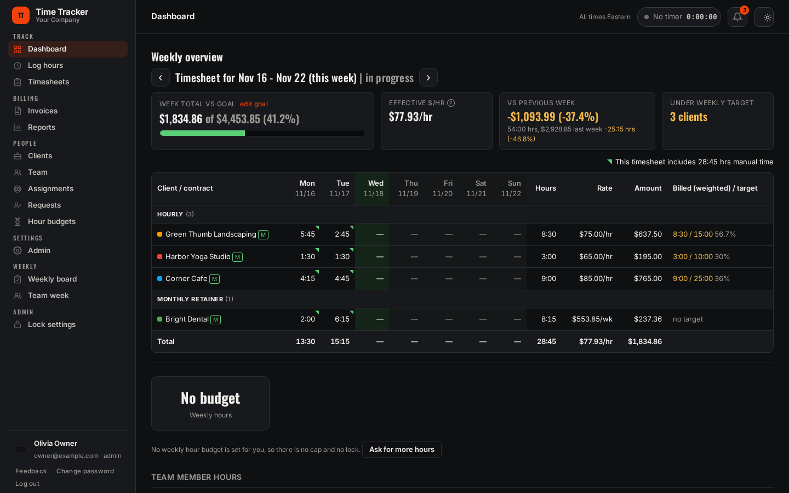
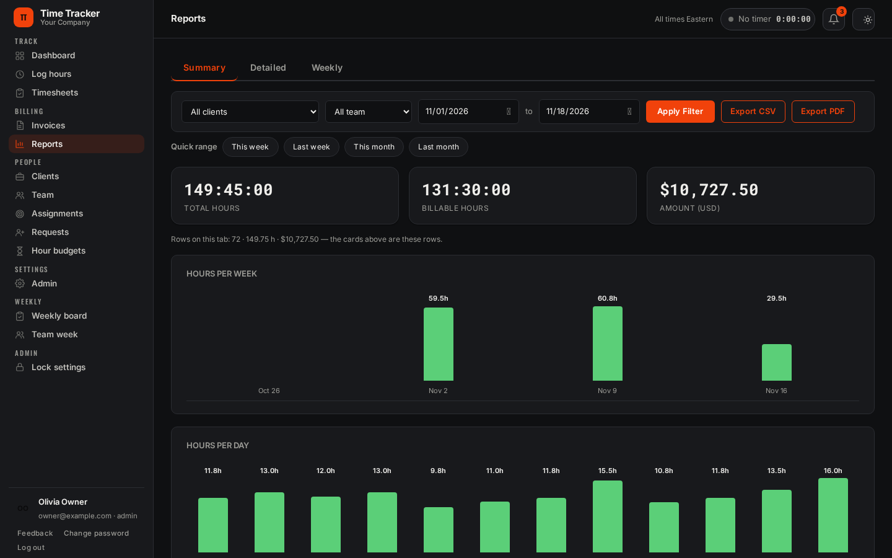
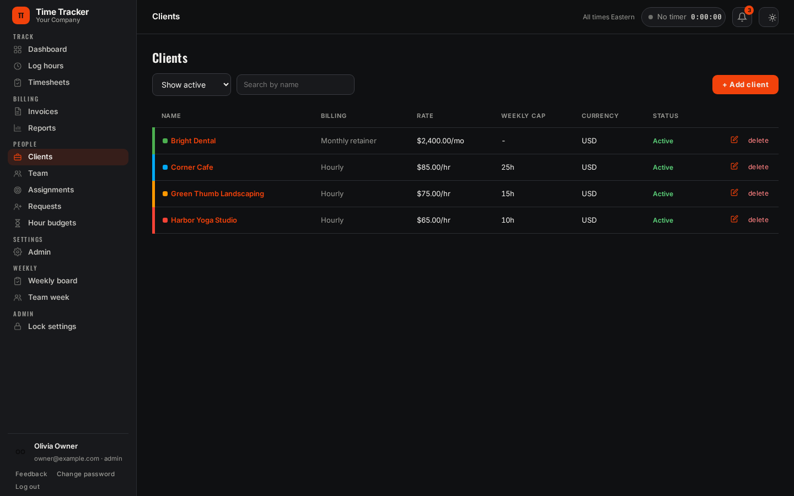
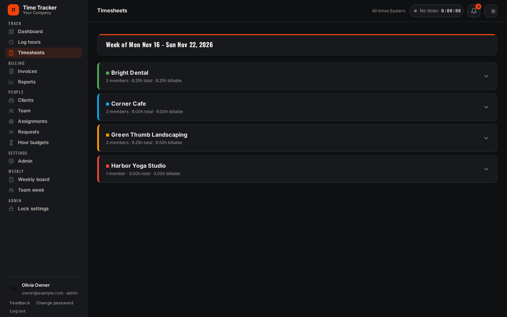
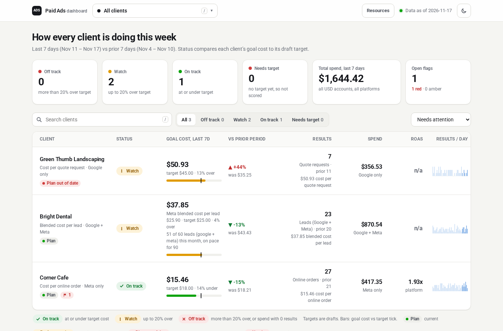
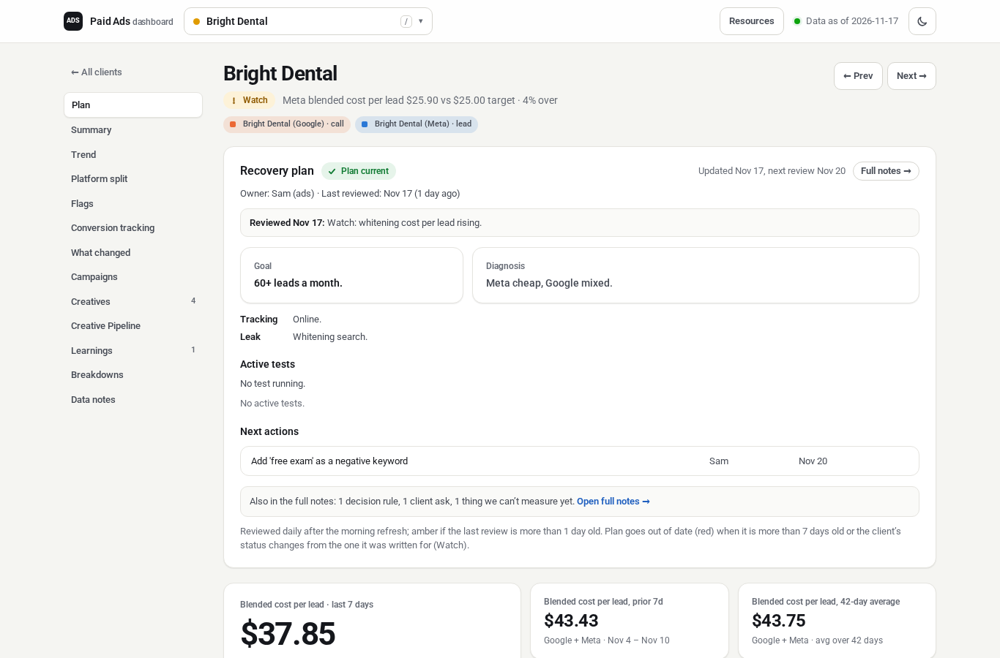

# Dashboards Starter Kit

Two small business apps you can run today and then have your own AI change to fit your business:

1. **Time Tracker** (`time-tracker/`): your team logs hours against clients. You get weekly timesheets, a dashboard of hours and money per client, client and team management, staff reports, and CSV and PDF exports.
2. **Paid Ads Dashboard** (`ads-dashboard/`): one page per client showing how their Meta (Facebook / Instagram) and Google Ads are doing against a target, what changed this week, which campaigns and ads are winning, warning flags, whether conversion tracking is working, and the written plan for each client.

Both apps open with **fake sample data**, so you can try them before you connect anything real. Every business, person, email and number in the demo is made up. The businesses are Corner Cafe, Bright Dental, Green Thumb Landscaping and Harbor Yoga Studio, and the email addresses all end in `@example.com`.

---

## What they look like

### Time Tracker

| Dashboard | Reports (CSV + PDF export) |
|---|---|
|  |  |

| Clients | Timesheets |
|---|---|
|  |  |

### Paid Ads Dashboard

| All clients this week | One client |
|---|---|
|  |  |

---

## Try it on your computer (about 5 minutes)

You need two free programs: **Node.js 22 or newer** (https://nodejs.org) and **Python 3** (https://python.org). On a Mac, Python is often already installed.

Download this folder (or `git clone` it), open a terminal in it, and run:

### Time Tracker

```bash
cd time-tracker
npm install        # one time only, downloads the PDF library
npm run demo
```

Open **http://localhost:8787** and sign in with any of these demo logins:

| Role | Email | Password |
|---|---|---|
| Owner (admin) | owner@example.com | demo-password-123 |
| Manager | sam@example.com | demo-password-123 |
| Employee | jo@example.com | demo-password-123 |

Demo mode keeps everything in memory. When you stop it (Ctrl+C), it forgets everything, and the next start loads the sample data again.

### Paid Ads Dashboard

```bash
cd ads-dashboard
python3 builder/make_demo_data.py            # optional: refreshes the sample data to end yesterday
python3 builder/build_data.py --source demo  # optional: rebuilds public/data.json from it
python3 -m http.server 8090 -d public
```

Open **http://localhost:8090**. Click a client name to see its full page.

---

## Put it online (so your team can use it)

Both apps are built for **Cloudflare**, which has a free tier. You can also host them anywhere that runs Node (time tracker) or serves static files (ads dashboard).

### Time Tracker on Cloudflare Workers

1. Create a free Cloudflare account. In the `time-tracker` folder, run `npx wrangler@4 login`.
2. Create the database: run `npx wrangler@4 d1 create time-tracker-db`, then copy the `database_id` it prints into `wrangler.toml`.
3. Build the tables: `npm run db:setup`
4. Set a one-time secret that lets you make the first admin: `npx wrangler@4 secret put BOOTSTRAP_SECRET`
5. Deploy: `npm run deploy`
6. Create your owner account by sending one request with that secret (your AI can do this for you):
   `POST /api/auth/register` with header `X-Bootstrap-Secret: <your secret>` and body `{"email": "...", "password": "...", "display_name": "..."}`.
   After that, add everyone else from the **Team** page inside the app.

Optional extras (emailing invoices, PayPal invoices, "Sign in with Google") each need their own keys. They are listed in `time-tracker/.dev.vars.example`. They stay switched off until you set them.

### Ads Dashboard on Cloudflare Pages (password protected)

1. `npx wrangler@4 login`
2. `bash deploy/deploy_cloudflare.sh my-ads-dashboard`
3. In Cloudflare, open the Pages project and go to **Settings > Variables and secrets**. Add `DASHBOARD_PASSWORD` as a Secret. Until you set it, the site stays locked.

The username is `team` unless you also set `DASHBOARD_USER`.

**Keep the ads dashboard private.** When it holds real data, `public/data.json` contains your clients' names and spend. Keep your copy of this repository **private**, and always deploy with the password gate.

---

## Connect your own ad accounts

The dashboard reads one file, `public/data.json`. You fill it in three steps:

1. **List your clients.** Copy `ads-dashboard/demo/config/clients.json` to `ads-dashboard/config/clients.json`. Then replace the sample businesses with your own: each client's name, ad account ids, and target, for example "cost per lead $45".
2. **Add your keys.** Copy `ads-dashboard/.env.example` to `ads-dashboard/.env` and fill in what you use:

   | Platform | What you need | Where to get it |
   |---|---|---|
   | Meta (Facebook / Instagram) | `META_ACCESS_TOKEN` with the `ads_read` permission | Meta Business Settings > Users > System users > Generate token |
   | Google Ads | `GOOGLE_ADS_DEVELOPER_TOKEN` | Google Ads manager account > Tools > API Center (approval can take a few days) |
   | Google Ads | `GOOGLE_ADS_CLIENT_ID`, `GOOGLE_ADS_CLIENT_SECRET` | Google Cloud console > Credentials > OAuth client ("Desktop app") |
   | Google Ads | `GOOGLE_ADS_REFRESH_TOKEN` | Created once by signing in with that OAuth client (your AI can walk you through it) |
   | Google Ads | `GOOGLE_ADS_LOGIN_CUSTOMER_ID` (optional) | Your manager account id, if you use one |

   The `.env` file never leaves your computer and is never saved to git.
3. **Pull and build:**

   ```bash
   python3 connectors/fetch_meta.py      # reads Meta, writes data/meta_rows.csv
   python3 connectors/fetch_google.py    # reads Google Ads, writes data/google_rows.csv
   python3 builder/build_data.py         # writes public/data.json
   ```

   Both connectors are **read-only**. They only run reports and never change anything in your ad accounts. Run them once a day, by hand or on a schedule.

The written parts of each client page live in `ads-dashboard/content/plans.json` and `ads-dashboard/content/learnings.json`. That includes the plan, the tests, the next actions and what you learned. You or your AI can write them in the same shape as the demo files in `ads-dashboard/demo/content/`.

---

## Tell your PureBrain:

Copy and paste any of these prompts. Change the parts in [brackets].

**Getting started**

> Clone this repository and run both apps in demo mode. Check that the time tracker opens on localhost:8787 and the ads dashboard opens on localhost:8090, then tell me what each page shows.

**Make the time tracker yours**

> In time-tracker, change the name "Time Tracker / Your Company" to "[My Business Name]". Change the orange brand colour to [#hex], and change the departments to [Design, Admin, Client calls]. Then run the demo and show me a screenshot.

> The time tracker uses US Eastern time everywhere. Change it to [Australia/Sydney] and check that the weekly timesheets still start on the right day.

> I don't send invoices from the time tracker. Hide the Invoices screen and the PayPal option from the menu without breaking anything else.

> Deploy the time tracker to my Cloudflare account, following the README. Create my owner account as [me@example.com], then add [names and emails] as employees.

**Make the ads dashboard yours**

> Set up config/clients.json for my clients: [Client A: Meta account 123..., goal $30 per lead], [Client B: Google Ads 456..., goal $50 per booking]. Walk me through getting the Meta and Google Ads keys into .env, then pull the data and build the dashboard.

> Every morning at 7am, run the Meta and Google connectors, rebuild data.json and redeploy the ads dashboard. Tell me if any client turned red.

> Each Monday, read the dashboard for each client and write a short plan in content/plans.json. Use the same shape as the demo: the goal, what's going wrong, one test to run, and next actions.

> Add a new red flag to the ads dashboard for any campaign whose cost per result doubled versus last week.

---

## What's in the folder

```
time-tracker/          The time tracker (Cloudflare Worker + D1 database)
  public/              The website your team sees (plain HTML, CSS, JavaScript)
  worker/src/          The server: logins, timesheets, clients, team, reports, CSV and PDF export
  schema.sql, migrations/, db/d1-setup.sql   The database layout
  demo/                Runs everything locally with fake data (no Cloudflare needed)
ads-dashboard/         The paid ads dashboard (one static page + a data file)
  public/index.html    The whole dashboard
  public/data.json     The numbers it shows (demo data until you build your own)
  connectors/          Read-only pulls from Meta and Google Ads
  builder/             Turns the pulled rows into data.json; makes the demo data
  demo/                The fake sample clients, rows and plans
  deploy/              Password gate + one-command Cloudflare Pages deploy
docs/screenshots/      The pictures above
```

## Good to know

- Each folder has its own README with the technical details for your AI.
- The time tracker has its own login system. Passwords are hashed and salted, logins are rate-limited, and staff only see the clients they are assigned to. Before your team uses it for real, have your AI review the sign-in setup for your hosting.
- The ads numbers are **what the ad platforms report**. They are not your own sales or booking records. Treat them as a guide, and check against your real sales.
- License: MIT (see `LICENSE`).
